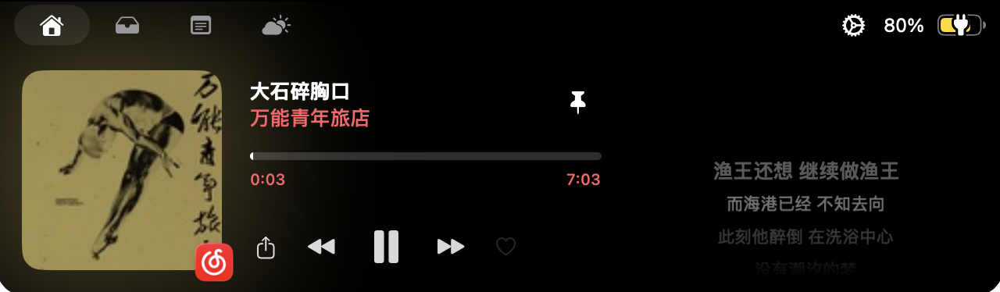
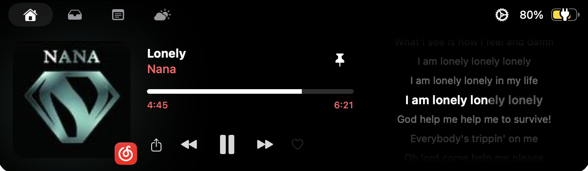

# Notch Lyrics 1.2.0 更新文稿（GitHub Release 用）

> 用法：建 Release 时把下面分隔线以内的内容贴进描述（或  
> `gh release create v1.2.0 --notes-file <本文件>`，注意会把标题也带进去）。  
> 上半是中文，下半是英文。  
> 图片引用写的是同目录相对路径（本地/GitHub 文件页都能显示）；贴进 Release 描述时  
> GitHub 按仓库根解析，要把 `` 改成 ``，  
> 或者直接在 Release 页面拖图上传。

---

## Notch Lyrics 1.2.0

误食了一碗乌冬面。  

（更新文档好难写啊啊啊啊啊）

不过我们从某个养殖场学到了一招：

“解决了一些已知问题。”

### 🎤 中文歌终于有词了

之前歌词只认 LRCLIB，英文老歌管够，中文新歌基本查无此人。  
这一版把网易云接进来了：歌名或歌手带中文，先问网易云，问不到再回头问 LRCLIB。  
《晴天》《七里香》《孤勇者》实测全中。纯音乐就标纯音乐，编出来的歌名就老实  
说没有——总比给你错的强。

中文歌有词的时候，长这样：

### 📌 歌词可以常驻了

播放时点一下图钉，刘海就钉住了：切去别的 App 干活、鼠标挪开，歌词都不动。  
图钉按下去会变纯白，省得再有人问「这按钮到底按上没有」。  
这条反馈我们收到了不止一次。对不起，改了。

长这样：

### 🔒 锁定当前播放器

开了「锁定」，刘海只听这一家的。  
别的软件接着放东西，也顶不掉你正在听的歌。

### 🎛 音乐软件名字统一了

「正在播放」改叫 Now Playing，「网易云音乐」改叫 NetEase Cloud Music。  
人家本来就叫这个，中英混排是我们自作多情。  
顺便网易云升成独立音源，跟 Apple Music、Spotify、YouTube Music 平起平坐。

### 🫳 拖拽真的能拖进去了

1.1.0 的暂存器有个见不得人的毛病：文件拖过去，刘海热情展开表示欢迎，  
你一松手，文件弹回 Finder。热情全在脸上，手上什么都没接。  
病根在窗口层，之前三轮都在 SwiftUI 那层打转，纯属给它背锅。  
现在真能拖进去了。拖到左边的隔空投送方块，还会直接弹系统分享面板。  
空着的暂存器也加了两步说明，免得它继续装深沉。

---

## Notch Lyrics 1.2.0 (English)

Accidentally ate a bowl of udon.  

(writing release notes is haaaaard)

But we learned a trick from a certain farm:

“Fixed some known issues.”

### 🎤 Chinese songs finally have lyrics

Lyrics used to come from LRCLIB alone — plenty of English classics, almost  
nothing for newer Chinese releases. This version wires in NetEase Cloud  
Music: Chinese title or artist asks NetEase first, then falls back to  
LRCLIB. Tested across a pile of Mandopop hits, all hits. Instrumental  
tracks say so, made-up song names get nothing — better than a wrong match.

A Chinese track with lyrics, looking like this:

### 📌 Pin the lyrics

Tap the pin while music plays and the notch stays put: switch apps, move  
the mouse away, the lyrics don't budge. The pin turns solid white when  
pinned, so nobody has to ask whether the button did anything.  
We got that question more than once. Sorry. Fixed.

Looks like this:

### 🔒 Lock onto one player

Turn the lock on and the notch listens to one player only.  
Whatever else starts playing, it can't shove your track off the screen.

### 🎛 Consistent app names

"正在播放" is now "Now Playing". "网易云音乐" is now "NetEase Cloud Music".  
That's what those apps call themselves; the mixed-script labels were us  
being overly helpful. NetEase Cloud Music also becomes a standalone media  
source, equal to Apple Music, Spotify, and YouTube Music.

### 🫳 Drag and drop actually drops

The 1.1.0 shelf had an embarrassing flaw: drag a file over, the notch opens  
warmly to welcome it, and the moment you let go the file bounces back to  
Finder. All the enthusiasm on its face, none of it in its hands.  
The root cause lived in the window layer; three earlier rounds were spent  
blaming SwiftUI, which was innocent.  
Files actually land now. Drop onto the AirDrop square on the left and the  
system share panel pops up. The empty shelf got two-step instructions too,  
so it can stop playing mysterious.
