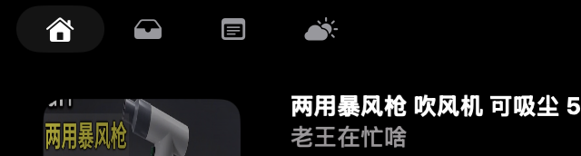

# Notch Lyrics 1.2.1 更新文稿（GitHub Release 用）

> 用法：建 Release 时把下面分隔线以内的内容贴进描述（或  
> `gh release create v1.2.1 --notes-file <本文件>`，注意会把标题也带进去）。  
> 上半是中文，下半是英文。  
> 图片引用写的是同目录相对路径（本地/GitHub 文件页都能显示）；贴进 Release 描述时  
> GitHub 按仓库根解析，要把 `` 改成 ``，  
> 或者直接在 Release 页面拖图上传。

---

## Notch Lyrics 1.2.1

三得利乌龙茶真好喝，嘻嘻嘻。

（上一版误食了一碗乌冬面，这一版改喝茶了。喝得越来越淡，改的也越来越少。）

### 🎹 纯音乐就直说纯音乐

以前放一首钢琴曲，查不到词，刘海会写「未找到歌词」——听着像我们没干活。  
现在它会写「纯音乐」。

判断不靠一家。歌词库自己标的算数（LRCLIB 的 `instrumental` 字段、网易云的
`nolyric`）；歌名和专辑里写着「纯音乐」「伴奏」「钢琴版」「instrumental」
「karaoke」这类字样的也算；连歌名后面挂着 `(Instrumental)` 这种版本标记的都能认出来。

顺手修了个一直没人提的毛病：以前《Song (Instrumental)》会被化简成《Song》去查，
查回来的是原唱的人声歌词——比空着还糟。现在直接判纯音乐，不查了。

### 📺 看视频的时候，它闭嘴了

在 Safari 里看 YouTube，用 PiLiPlus 看 B 站，右侧以前也会挂一句「未找到歌词」。  
现在什么都不显示。位置留着，就是空的。

这种东西本来就没有歌词，谈不上「没找到」。说「没找到」，等于在回答一个没人问的问题。

判断用的是白名单，只认音乐 App：Apple Music、Spotify、网易云、QQ 音乐、
YouTube Music 桌面版这些算，其余一律不显示。

代价写在明处：浏览器里放的 YouTube Music 网页版也会被当成视频，不显示歌词。  
分不出来，就不猜。

---

## Notch Lyrics 1.2.1 (English)

Suntory oolong tea is genuinely good. Hehe.

(Last time we accidentally ate a bowl of udon; this time we switched to tea.
The drinks get lighter, and so do the changes.)

### 🎹 Instrumentals say so

A piano piece used to come back as "No lyrics found", which reads like we
didn't even try. Now it says "Instrumental".

More than one source decides it. Whatever the lyric databases mark themselves
(LRCLIB's `instrumental` field, NetEase's `nolyric`) counts; so does the usual
wording in the title or album — 纯音乐, 伴奏, 钢琴版, instrumental, karaoke —
and so do version tags like "(Instrumental)" hanging off a title.

We also fixed something nobody had reported: "Song (Instrumental)" used to be
reduced to "Song" and answered with the vocal version's lyrics, which is worse
than showing nothing. It is now recognised as an instrumental and never looked up.

### 📺 It stays quiet for video

A YouTube tab in Safari, a Bilibili video in PiLiPlus — the right-hand side used
to carry "No lyrics found" as well. Now it shows nothing at all: the space stays,
it is just empty.

There were never any lyrics to find. Saying "not found" answers a question
nobody asked.

The check is a whitelist of music apps. Apple Music, Spotify, NetEase Cloud
Music, QQ Music and the YouTube Music desktop app qualify; everything else
shows nothing.

The trade-off, stated plainly: YouTube Music in a browser counts as video and
gets no lyrics. When it cannot be told apart, we do not guess.

